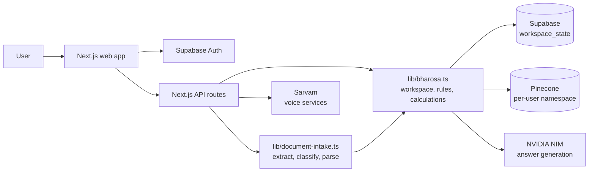
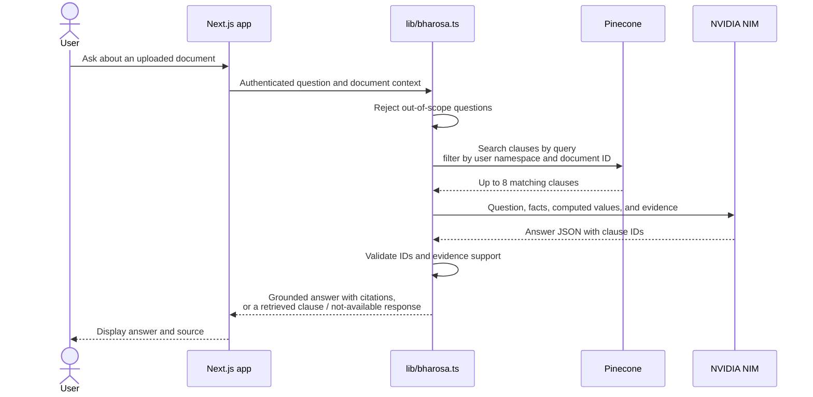

# Bharosa AI

Bharosa AI helps people understand financial documents before they sign, pay, or renew. It supports loan agreements and Key Fact Statements (KFS), health insurance policies, and credit card terms (MITC). It extracts key terms, explains document clauses, highlights risks, and runs deterministic financial scenarios.

> **Scope:** Bharosa AI provides document-based guidance. It is not a bank, insurer, lender, or financial adviser. It does not approve claims or move money.

## Architecture




### Main components

| Component | Responsibility |
|---|---|
| Next.js App Router | Web UI and server-side API routes |
| Supabase Auth | User sign-in and identity |
| `lib/document-intake.ts` | Reads uploaded files, extracts text, identifies supported document types, and derives fields and clauses |
| `lib/bharosa.ts` | Workspace state, chat and citation flow, document actions, and deterministic financial rules/calculations |
| `lib/pinecone.ts` | Indexes and retrieves document clauses through Pinecone's integrated embedding search |
| `lib/nvidia.ts` | Calls NVIDIA NIM for evidence-grounded answer generation and stress-test narration |
| `lib/db.ts` | Loads and saves workspace snapshots in Supabase's `workspace_state` table |
| `lib/sarvam.ts` | Voice-related integration |

Uploaded document clauses are indexed in a Pinecone namespace derived from the authenticated user ID. Searches are additionally filtered by document ID. Pinecone's integrated embedding model is configured in the implementation as `llama-text-embed-v2` (1024 dimensions); the application does not create or send raw embedding vectors itself.

Workspace snapshots are persisted in Supabase. The upload flow parses the file and saves the resulting workspace; it does not, by itself, establish a separate permanent file-storage location for the original upload.

## Document upload and indexing flow

1. The signed-in user submits a document to `app/api/documents/upload/route.ts`.
2. The route authenticates the user, applies an upload rate limit, and reads the submitted file.
3. `lib/document-intake.ts` extracts page text, classifies the document, and checks that it is a supported financial document.
4. Bharosa extracts facts and clauses. If required financial fields are missing, the API asks the user to provide them rather than running calculations with incomplete inputs.
5. `lib/bharosa.ts` adds the parsed document to the user's workspace and persists the workspace snapshot through `lib/db.ts`.
6. For an authenticated user, the app indexes the document's clauses in Pinecone. Clause text and metadata such as page, section, and document ID are indexed in that user's namespace.

## Question-answering (RAG) flow



The main retrieval and answer-generation steps are in `lib/bharosa.ts`. Pinecone performs semantic retrieval; NVIDIA NIM writes the natural-language response. The application asks the model to use only supplied evidence and computed values, then checks that cited clause IDs exist and that the answer is supported by cited text. Unsupported model answers are not accepted as grounded answers. If retrieval or model generation does not produce an accepted answer, the app can show a retrieved clause directly or report that the document does not provide the answer.

The app does not specify a custom vector-similarity algorithm in its code; Pinecone performs the integrated embedding search. `top_k` defaults to 8 for document retrieval.

## Financial calculations and scenarios

Financial values are parsed from the document or explicitly supplied by the user. Deterministic rules calculate loan, insurance, and card scenarios; the language model is not used to calculate those figures. For stress-test narration, NVIDIA NIM receives the already-computed scenario values and explains them without recalculating them.

## Authentication, privacy, and service health

- API operations that require an account use the authenticated user context.
- Pinecone namespaces are derived from user IDs, and retrieval is filtered to the requested document.
- Supabase stores workspace snapshots in `workspace_state`; database access and row-level security should be configured in Supabase for the deployed project.
- Keep service keys in environment variables. Never commit API keys or secrets.
- `app/api/health/route.ts` reports database, Pinecone, NVIDIA configuration, and voice-service configuration status.

## Pages

| Route | Purpose |
|---|---|
| `/` | Product overview |
| `/login` | Sign in or create an account |
| `/dashboard` | Document workspace, analysis, risks, scenarios, and chat |
| `/app` | Mobile-style customer view |
| `/admin` | Owner panel |

## Run locally

1. Install dependencies:

   ```bash
   npm install
   ```

2. Create a local `.env` file and configure the services you want to use:

   | Variable | Purpose |
   |---|---|
   | `NEXT_PUBLIC_SUPABASE_URL` | Supabase project URL |
   | `NEXT_PUBLIC_SUPABASE_ANON_KEY` | Supabase client/auth key |
   | `SUPABASE_SERVICE_ROLE_KEY` | Server-side Supabase access |
   | `PINECONE_API_KEY` | Pinecone API authentication |
   | `PINECONE_HOST` | Pinecone index host |
   | `PINECONE_INDEX` | Pinecone index name; defaults to `paytm` |
   | `NVIDIA_API_KEY` | NVIDIA NIM authentication |
   | `NVIDIA_MODEL` | NVIDIA model override; defaults to `nvidia/nemotron-3.5-lightning-30b-a3b` |
   | `SARVAM_API_KEY` | Sarvam voice-service authentication |

3. Start the development server:

   ```bash
   npm run dev
   ```

   Open [http://localhost:3000](http://localhost:3000).

4. Check the TypeScript project and build:

   ```bash
   npx tsc --noEmit
   npm run build
   ```

## Google sign-in

In Supabase Authentication settings, enable Google and add the app callback URL:

- `http://localhost:3000/auth/callback`
- `https://<your-production-domain>/auth/callback`

## Repository map

```text
app/                  Next.js pages and API routes
components/           UI components
lib/
  api-auth.ts         Authenticated API request helpers
  bharosa.ts          Workspace, RAG orchestration, rules, and calculations
  db.ts               Supabase workspace persistence
  document-intake.ts  File text extraction and document analysis
  nvidia.ts           NVIDIA NIM calls and evidence validation
  pinecone.ts         Pinecone indexing, retrieval, and health check
  sarvam.ts           Voice integration
```
